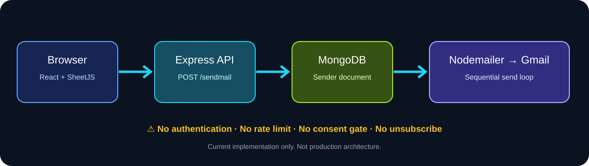
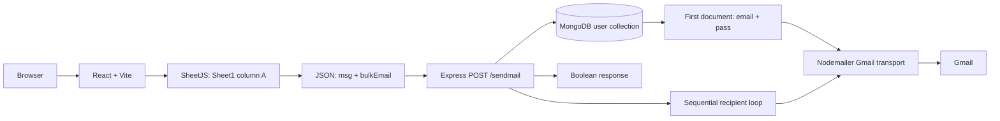

# 📬 Bulk Mail Project

<p align="center"></p>
<p align="center"><strong>Excel recipient import + React frontend + Express mail API</strong></p>
<p align="center"></p>

> [!CAUTION]
> **Not production safe.** The current `POST /sendmail` endpoint has no authentication, authorization, rate limit, recipient cap, request validation, consent enforcement, unsubscribe workflow, or abuse monitoring. Do not expose it publicly or use real recipient lists. Read [SECURITY.md](SECURITY.md).

## 🧭 Overview

This repository contains two separate npm applications. The React/Vite frontend accepts a plain-text message and an Excel workbook. SheetJS reads a worksheet named `Sheet1`, extracts column `A`, and Axios sends the message plus extracted values to an Express API. The backend uses Mongoose to read a sender credential document from MongoDB and Nodemailer to send messages sequentially through Gmail.

This is a learning prototype for browser file handling, workbook parsing, HTTP APIs, MongoDB connectivity, and mail transport integration. It is not a campaign-management platform, CRM, newsletter product, or compliant bulk-mail service.

## ✨ Current workflow

1. Enter a plain-text message.
2. Select an Excel workbook.
3. The frontend reads `Sheet1` and maps column `A` into `bulkEmail`.
4. The UI displays the number of extracted values.
5. Axios posts `{ msg, bulkEmail }` to `POST /sendmail`.
6. Express reads the first document in MongoDB's `user` collection for sender credentials.
7. Nodemailer sends one message per submitted value in a sequential loop.
8. The API returns a boolean, not a per-recipient delivery report.

No address validation, deduplication, consent verification, or delivery-state tracking is implemented.

## 🧰 Stack

| Layer | Technology | Responsibility |
|---|---|---|
| UI | React 18 | Message/file input and sending state |
| Build | Vite 6 | Frontend dev server and static build |
| Styling | Tailwind CSS 3 | UI styling |
| Workbook | SheetJS `xlsx` | Reads `Sheet1`, column `A` |
| HTTP | Axios | Frontend API request |
| API | Node.js, Express 4 | `POST /sendmail`, port 3000 |
| Database | MongoDB, Mongoose 8 | Sender credential lookup |
| Email | Nodemailer 6, Gmail | Outbound message submission |

There is no root `package.json` or npm workspace.

## 🏗️ Architecture

<p align="center"></p>



The route is registered inside the successful MongoDB lookup callback. If the database lookup fails or no credential document exists, the route may never be registered. See [Architecture](docs/architecture.md).

## 🗂️ Repository structure

```text
Bulk-Mail-Project/
├── .github/
│   ├── ISSUE_TEMPLATE/
│   ├── workflows/
│   └── pull_request_template.md
├── backend/
│   ├── index.js                 # Express, MongoDB, Nodemailer
│   ├── package.json
│   └── package-lock.json
├── frontend/
│   ├── public/
│   ├── src/
│   │   ├── App.jsx              # Workbook parsing and API call
│   │   ├── main.jsx
│   │   └── index.css
│   ├── package.json
│   └── package-lock.json
├── docs/
│   ├── assets/                  # Original SVG illustrations
│   ├── diagrams/                # Editable Mermaid sources
│   ├── runbooks/                # Operational procedures
│   ├── templates/               # Review and test templates
│   └── *.md                     # Engineering guides
├── scripts/                     # Documentation validation
├── .env.example
├── CHANGELOG.md
├── CODE_OF_CONDUCT.md
├── CONTRIBUTING.md
├── LICENSE
├── ROADMAP.md
├── SECURITY.md
└── SUPPORT.md
```

## 📊 Workbook format

The parser expects a worksheet named exactly `Sheet1` and recipient values in column `A`. It uses `sheet_to_json(..., { header: "A" })`, so a header in A1 is not automatically skipped. The current code does not explicitly validate missing sheets, blank rows, address syntax, duplicates, file size, or recipient count. Use synthetic data and reserved `.test` addresses only. See [Workbook format](docs/workbook-format.md).

## 🚀 Local setup

Requirements: Node.js, npm, disposable MongoDB, and only a controlled test mailbox if examining provider integration.

```bash
git clone https://github.com/Brajesh31/Bulk-Mail-Project.git
cd Bulk-Mail-Project
cp .env.example backend/.env
cp .env.example frontend/.env.local
```

PowerShell:
```powershell
Copy-Item .env.example backend/.env
Copy-Item .env.example frontend/.env.local
```

Backend terminal:
```bash
cd backend
npm ci
node index.js
```

Frontend terminal:
```bash
cd frontend
npm ci
npm run dev
```

Open the Vite URL printed in the terminal, commonly `http://localhost:5173`. Set backend `FRONTEND_URL` to that exact origin. Backend listens on fixed port `3000`.

Frontend quality commands:
```bash
npm run lint
npm run build
```
Run these from `frontend/`. Backend's current test command is a placeholder that exits with an error. No meaningful backend test suite is configured.

## ⚙️ Configuration

| Variable | Consumer | Purpose |
|---|---|---|
| `DATABASE_URL` | Backend | MongoDB connection string |
| `FRONTEND_URL` | Backend | Exact CORS origin |
| `VITE_APP_BASE_URL` | Frontend | Public API base URL |

Vite variables prefixed with `VITE_` are exposed in browser assets. Never put secrets there. See [Configuration](docs/configuration.md).

## 🔌 API contract

`POST /sendmail` accepts:
```json
{"msg":"A message for recipients who opted in.","bulkEmail":["person@example.test"]}
```
The backend returns `true` if the sequential loop resolves, or `false` if it rejects. There are no structured errors or per-recipient outcomes. The endpoint is unauthenticated and must not be exposed publicly. See [API](docs/api.md).

## ⚠️ Known limitations

| Area | Current behavior | Consequence |
|---|---|---|
| Authentication/authorization | None | Anyone reaching API can attempt sends |
| Validation | No backend schema | Malformed input can fail unpredictably |
| Abuse controls | No rate or recipient cap | Spam/quota exhaustion risk |
| Consent/unsubscribe | Not implemented | No permission or preference controls |
| Queue | Sequential in HTTP request | Long requests and partial-send ambiguity |
| Delivery status | Boolean only | No recipient-level outcome |
| Secrets | Mailbox credentials read from MongoDB | Unsafe credential pattern |
| Logging | Recipient array logged | Personal data exposure in logs |
| Frontend errors | Axios rejection not handled | UI may remain in sending state |
| Tests | No meaningful backend suite | Behavior not automatically verified |

These are source observations, not features fixed by documentation.

## 🛡️ Security and responsible use

- Do not expose the backend publicly or use real recipients.
- Rotate credentials that appeared in historical commits. Deleting a file does not invalidate a secret.
- Do not store mailbox passwords in MongoDB.
- CORS is not authentication.
- Before real use, implement authentication, authorization, server-side validation, recipient/message limits, rate limiting, consent, suppression, unsubscribe, safe logs, and abuse monitoring.
- Never log recipient lists or message bodies.
- Follow provider rules and applicable privacy/anti-spam requirements.

Read [SECURITY.md](SECURITY.md), [Email safety](docs/email-safety.md), and [Threat model](docs/threat-model.md).

## 📚 Documentation index

- [Documentation hub](docs/README.md)
- [Product overview](docs/product-overview.md)
- [Architecture](docs/architecture.md)
- [Workbook format](docs/workbook-format.md)
- [API](docs/api.md)
- [Database](docs/database.md)
- [Configuration](docs/configuration.md)
- [Installation](docs/installation.md)
- [Development](docs/development.md)
- [Deployment](docs/deployment.md)
- [Email safety](docs/email-safety.md)
- [Threat model](docs/threat-model.md)
- [Testing](docs/testing.md)
- [Observability](docs/observability.md)
- [Runbooks](docs/runbooks/README.md)
- [Diagrams](docs/diagrams/README.md)
- [Templates](docs/templates/README.md)

## 🗺️ Roadmap

1. **P0 Security:** rotate historical credentials, remove database-stored mailbox passwords, add authentication, validation, rate limits, recipient caps, safe logs.
2. **P1 Consent:** consent records, suppression, unsubscribe, sender identity, provider-policy review.
3. **P2 Reliability:** queue, idempotency, per-recipient states, bounded retries, partial-failure reporting.
4. **P3 UX:** workbook preview, invalid-row report, duplicate handling, accessible feedback, robust network errors.
5. **P4 Operations:** health checks, metrics, retention, deployment automation, recovery exercises.

Planned work is not current functionality. See [ROADMAP.md](ROADMAP.md).

## 🤝 Contributing

Read [CONTRIBUTING.md](CONTRIBUTING.md), follow [CODE_OF_CONDUCT.md](CODE_OF_CONDUCT.md), and use repository issue/PR templates. Submit security reports privately as described in [SECURITY.md](SECURITY.md).

## 📄 License

MIT. See [LICENSE](LICENSE). Third-party dependencies and assets retain their own licenses.

<p align="center"><strong>Built as a learning project. Protect recipient data and never send mail without permission.</strong></p>

Last updated: 2026-11-20 11:05 UTC
