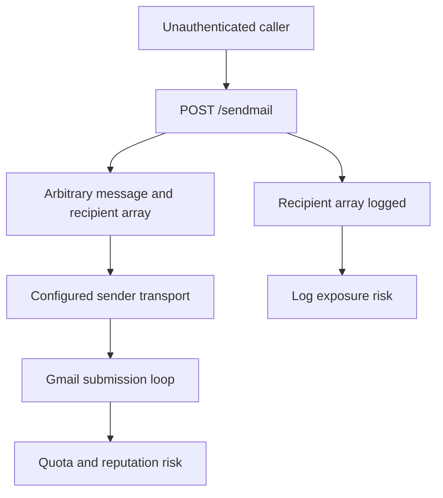

# Threat model

## Scope and assets

This model covers the checked-in browser frontend, Express API, MongoDB credential lookup, and Gmail transport.

| Asset | Impact if compromised |
|---|---|
| MongoDB connection credential | Unauthorized database access |
| Gmail mailbox credential | Unauthorized outbound mail |
| Recipient addresses | Personal data exposure and abuse |
| Message content | Confidentiality/reputation harm |
| Sender identity | Impersonation and reputation damage |
| Provider quota | Service interruption/account restriction |

## Trust boundaries

1. Browser-to-API: client input is untrusted; API has no authentication.
2. API-to-MongoDB: connection uses `DATABASE_URL`.
3. API-to-Gmail: Nodemailer credentials come from a database document.
4. Logs: recipient arrays are currently logged.
5. Git history: deleting a secret from the latest tree does not remove earlier commits.

## Threat register

| Threat | Current weakness | Potential impact | Required mitigation |
|---|---|---|---|
| Unauthorized send | No authentication/authorization | Sender account abuse | AuthN, AuthZ, sender ownership |
| Bulk abuse | No recipient/rate cap | Spam and quota exhaustion | Quotas, throttling, kill switch |
| Malformed payload | No schema validation | Runtime failure/unexpected sends | Strict server validation |
| Credential compromise | Historical env values; credentials in DB | Mailbox/database takeover | Rotate, secret manager, least privilege |
| Data leakage | Recipient array logged | Personal data exposure | Redaction/minimization |
| Consent bypass | No consent/suppression gate | Unwanted mail | Consent ledger and suppression |
| Partial-send ambiguity | Boolean response | Duplicate retry or false success | Per-recipient state/idempotency |
| CORS misunderstanding | Browser-origin control only | Direct clients bypass CORS | Authentication and network controls |
| Startup failure | Route registration follows DB lookup | API unavailable | Explicit startup validation/health |
| Malicious workbook | No file limits | Resource pressure | File limits and validation |

## Abuse path

## Prioritized mitigations

**P0:** rotate historical secrets; authenticate and authorize; remove mailbox passwords from MongoDB; validate request schema; enforce message/recipient limits and rate limits; stop logging recipient arrays; check consent and suppression.

**P1:** queue messages; add bounded concurrency, idempotency, per-recipient state, unsubscribe processing, bounce/complaint ingestion, monitoring, and a pause switch.

**P2:** define retention/deletion, audit access, exercise incident response, and conduct independent security review.

External providers may defer, reject, or classify messages as spam. The application must not promise inbox placement.
